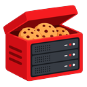

# NiBoites — Extension navigateur

[](https://github.com/nihost/niboites-browser/actions/workflows/ci.yml)

**NiBoites by NiHost** est une extension Chrome / Edge / Firefox (Manifest V3) pour contrôler et gérer vos **boîtes et serveurs** depuis votre navigateur, via l'[API publique NiBoites v1](https://boites.ni-host.com/docs). Le panel reste [boites.ni-host.com](https://boites.ni-host.com) ; l'extension couvre les actions routinières (statut, power, console, backups) sans ouvrir le panel.



## Fonctionnalités

- **Liste de vos boîtes** avec leurs specs (RAM, CPU, disque, nombre max de serveurs)
- **Serveurs par boîte** avec statut en temps réel (en ligne / arrêté / démarrage…)
- **Contrôle power** : démarrer, arrêter, redémarrer, tuer un serveur en un clic
- **Console** : envoyer des commandes directement au serveur
- **Backups** : lister, déclencher, **restaurer** et **supprimer** une sauvegarde
- **Planifications** : lister, **exécuter maintenant**, activer/désactiver, **créer** et supprimer des tâches cron
- **Métriques** : état, CPU %, barres mémoire/disque utilisées en temps réel
- **SFTP** : hôte, port et identifiant de connexion (le mot de passe reste dans le panel)
- **Actualisation automatique** configurable (intervalle réglable)
- **Badge** sur l'icône de l'extension indiquant le nombre de serveurs en ligne
- **Raccourci clavier** `Ctrl+Shift+R` (ou `Cmd+Shift+R` sur Mac) pour tout rafraîchir
- **Notifications** quand le nombre de serveurs en ligne change
- Token stocké **localement** dans le navigateur (`chrome.storage.local`)

## Build

Aucun bundling ni compilation : l'extension est en **HTML/CSS/JS vanilla (Manifest V3)**, sans aucune dépendance (`npm install` inutile).

Un seul script pour valider + packager :

```bash
./scripts/build.sh          # valide + génère dist/niboites-<version>.zip
node scripts/validate-manifest.js   # validation structurelle du manifest MV3 seule
```

La **CI GitHub Actions** (`.github/workflows/ci.yml`) exécute ces mêmes contrôles à chaque push/PR sur `main` et publie le `.zip` en artifact téléchargeable.

Il :
1. valide `manifest.json` et les locales (`_locales/*/messages.json`)
2. vérifie la syntaxe de tous les JS (`node --check`)
3. génère **`dist/niboites-<version>.zip`** (manifest.json à la racine du zip, prêt à uploader)

Pré-requis : `python3`, `node`, `zip`, `rsync` (tous présents par défaut sur macOS + brew).

### Pour distribuer

| Cible | Fichier à fournir |
|---|---|
| Chrome Web Store / Edge Add-ons | `dist/niboites-<version>.zip` (uploader tel quel) |
| Firefox AMO | idem, ou le dossier dézippé |
| `.crx` signé (hors store) | `google-chrome --pack-extension=. --pack-extension-key=key.pem` |

## Installation

1. Clonez ce dépôt : `git clone https://github.com/nihost/niboites-browser.git`
2. **Chrome / Edge** : ouvrez `chrome://extensions`, activez le **mode développeur**, cliquez sur **« Charger l'extension non empaquetée »** et sélectionnez le dossier cloné (ou dézippez `dist/niboites-<version>.zip` et chargez le dossier obtenu).
   **Firefox** : ouvrez `about:debugging#/runtime/this-firefox`, cliquez sur **« Charger un module temporaire »** et sélectionnez le fichier `dist/niboites-<version>.zip` (ou n'importe quel fichier du dossier dézippé, ex. `manifest.json`).
3. Cliquez sur l'icône de l'extension **NiBoites** dans la barre d'outils, puis sur **Options**
4. Collez votre **jeton API** (créé sur [boites.ni-host.com](https://boites.ni-host.com) > Compte > API) puis cliquez sur **Tester le jeton**

## Utilisation

- Cliquez sur l'icône de l'extension dans la barre d'outils pour ouvrir le popup
- Cliquez sur une boîte pour déplier/replier ses serveurs
- Survolez un serveur et utilisez les boutons de contrôle (démarrer / arrêter / redémarrer / tuer)
- Cliquez sur le bouton « … » pour ouvrir la fiche détaillée (console, backups, planifications)

## API utilisée

| Endpoint | Scope | Usage dans l'extension |
|---|---|---|
| `GET /v1/me` | `read` | Validation du jeton, email du compte |
| `GET /v1/boites` | `read` | Liste des boîtes |
| `GET /v1/boites/{id}/servers` | `read` | Serveurs de chaque boîte |
| `GET /v1/servers/{id}` | `read` | Détail serveur (fiche « … ») |
| `GET /v1/servers/{id}/metrics` | `read` | Métriques temps réel (CPU, RAM, disque) |
| `GET /v1/servers/{id}/sftp` | `read` | Infos de connexion SFTP |
| `GET /v1/servers/{id}/backups` | `read` | Liste des sauvegardes |
| `GET /v1/servers/{id}/schedules` | `read` | Tâches planifiées |
| `POST /v1/servers/{id}/power?signal=…` | `power` | start / stop / restart / kill |
| `POST /v1/servers/{id}/command` | `power` | Envoi de commande console |
| `POST /v1/servers/{id}/backups` | `power` | Déclenchement d'une sauvegarde |
| `DELETE /v1/servers/{id}/backups/{backupId}` | `power` | Suppression d'une sauvegarde |
| `POST /v1/servers/{id}/backups/{backupId}/restore` | `power` | Restauration (`truncate` optionnel) |
| `POST /v1/servers/{id}/schedules` | `power` | Création d'une tâche cron |
| `PATCH /v1/servers/{id}/schedules/{scheduleId}` | `power` | Modification / activation |
| `DELETE /v1/servers/{id}/schedules/{scheduleId}` | `power` | Suppression d'une tâche |
| `POST /v1/servers/{id}/schedules/{scheduleId}/run` | `power` | Exécution immédiate d'une tâche |

> Attention : les actions power/commande/backup nécessitent un token avec le scope **`power`**.
> Limite : **60 requêtes/minute** par token (HTTP 429 au-delà).

## Structure du projet

```
niboites-browser/
├── manifest.json          # Manifest V3
├── _locales/              # Traductions fr / en
├── icons/                 # Icônes PNG (16/48/128)
├── lib/
│   └── api.js             # Client API NiHost + helpers├── popup/
│   ├── popup.html         # Interface principale
│   └── popup.js           # Logique du popup
├── css/
│   └── popup.css          # Styles
├── options/
│   ├── options.html       # Page de configuration du token
│   └── options.js
└── background/
    └── background.js      # Service worker (badge, alarmes, raccourcis)
├── scripts/
│   └── build.sh           # Validation + packaging .zip (dist/)
└── dist/                  # Généré par build.sh (gitignoré)
```

## Conformité produit (product.md)

L'extension suit les engagements de marque NiBoites / NiHost :

- **Palette** : primary `#DD4E49`, blue `#49A5DD`, green `#49DDA7`, orange `#DD9C49`, ink `#494949`
- **Thème clair par défaut** (light-primary) avec **toggle sombre**, persisté localement
- **Typographie** : Raleway (UI), Montserrat (titres), monospace (console)
- **Co-branding** : « NiBoites by NiHost » dans le popup et les options
- **Logo** : mascotte officielle NiBoites (la boîte-cookie, `icons/logo-cookie.svg`) pour les icônes d'extension et le header
- **Terminologie** : toujours « boîte / boîtes » dans les textes visibles (FR et EN), jamais « box »
- **FR-first** : FR langue de référence, EN fourni ; lien panel vers boites.ni-host.com, commande/facturation/support vers ni-host.com
- **Accessibilité** : focus visibles (`:focus-visible`), modale au clavier (Échap, focus à l'ouverture), en-têtes de boîte activables au clavier
- **Copy** : aucun claim inventé, pas de « unlimited servers », jeux : Minecraft, Hytale, « and more »

## Versionning & releases

Versionnage **sémantique** (semver) : `manifest.json` est la source de vérité, le `CHANGELOG.md` suit [Keep a Changelog](https://keepachangelog.com/fr/1.1.0/) (section `[Unreleased]` alimentée au fil des PR).

Publier une release :

```bash
./scripts/bump.sh patch        # ou minor / major : bump manifest + CHANGELOG + commit + tag vX.Y.Z
git push github main
git push github vX.Y.Z         # déclenche .github/workflows/release.yml
```

Le workflow `release.yml` (tags `v*`) build le `.zip`, extrait les notes du `CHANGELOG.md` et publie une **release GitHub** avec `dist/niboites-<version>.zip` en asset.

## Open source

Ce projet est publié en open source par **NiHost** sur [github.com/nihost/niboites-browser](https://github.com/nihost/niboites-browser), licence **MIT** (voir `LICENSE`). Contributions bienvenues (issues, pull requests).

## Sécurité

- Le token n'est jamais envoyé ailleurs que vers `https://boites.ni-host.com`
- Stockage local uniquement (`chrome.storage.local`), jamais de stockage cloud
- Aucun tracking, aucun code tiers

## Licence

MIT
